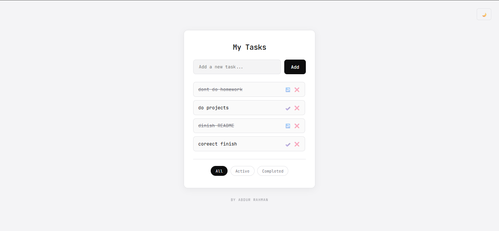
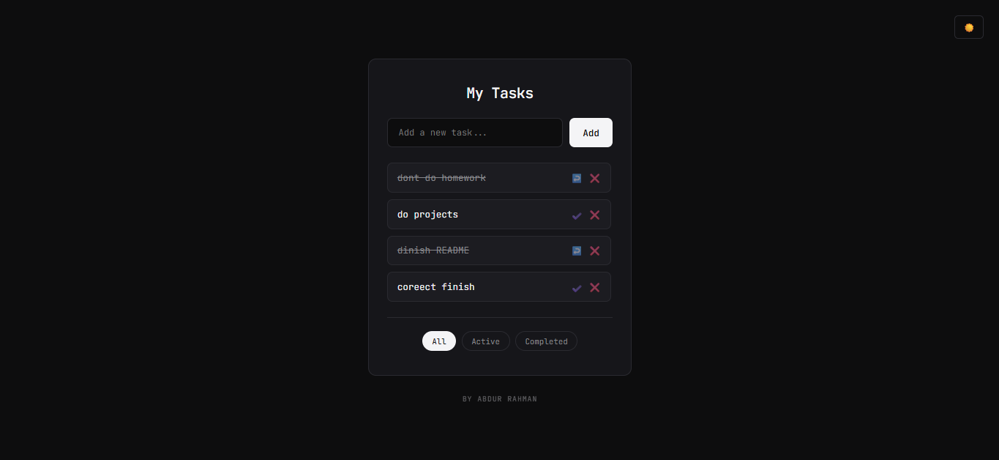

# Minimalist To-Do List

A lightweight task list for the browser, built with **HTML, CSS, and vanilla JavaScript**. Tasks can be added, marked complete, removed, and filtered. The app stores the list in browser `localStorage` so it remains available after a refresh on the same browser.

## Features

- Add tasks from the input field
- Mark tasks active or completed
- Delete tasks
- Filter the list by all, active, or completed tasks
- Persist tasks in `localStorage`
- Light and dark themes

## Run locally

Open `to-do list/index.html` in a browser. Keep the `to-do list/assets/` folder beside the page.

## Built with

- HTML5
- CSS3
- Vanilla JavaScript

## Screenshot

